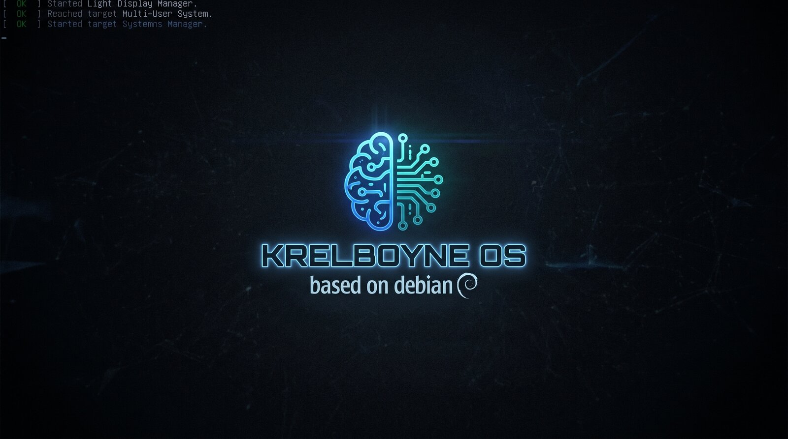

  

# KrelboyneOS

A Debian 13 (trixie) live and installable Linux distribution for developers and security learners, with an Xfce desktop and the tools already set up.

Website: [krelboyneos.org](https://krelboyneos.org)

**Status: 0.1.6 alpha.** It boots and installs in a virtual machine, including with full-disk encryption, and runs installed on a Dell Latitude 7420. Testing on more hardware is still ahead.

## What it is

KrelboyneOS is a custom Linux ISO built with [live-build](https://wiki.debian.org/DebianLive). Boot it to try it, or install it to disk with the Calamares installer. The goal is a machine that is ready for software development and security work the moment it finishes installing, with no afternoon of setup first.

It started as a Linux From Scratch idea and became a Debian-based distro, so the focus is on a useful daily workstation.

## What's in it

**Desktop and look**
- Xfce on LightDM with the Arc-Dark theme and Papirus icons
- Dark teal KrelboyneOS branding on the boot menus, boot splash, installer, login screen and desktop
- conky system monitor on the desktop

**Shell and terminal**
- zsh with Oh My Zsh, autosuggestions, syntax highlighting and a two-line prompt
- zoxide, fzf, ripgrep, fd, bat, tmux, neovim, jq, htop, btop
- Kitty terminal, JetBrainsMono and FiraCode Nerd Fonts

**Development**
- git, git-lfs, lazygit, GitHub CLI
- Python 3 (pip, venv, pipx), Node.js and npm, mise for other languages
- build-essential, cmake, ninja, clang, gdb
- VS Code and httpie for APIs
- PostgreSQL and SQLite
- Docker and Docker Compose
- KVM, QEMU, libvirt and virt-manager

**Security**
- nmap, Wireshark and tshark, tcpdump, netcat, mtr, traceroute, whois, dig, iperf3
- OpenVPN and WireGuard
- aircrack-ng, John the Ripper, hashcat, Hydra, sqlmap, gobuster, Nuclei
- Bruno, Metasploit, BloodHound CE, Burp Suite Community and about 70 more optional tools install on demand from the KOS Software app (System menu), which also updates the system and opens GNOME Software for everything else
- KOS Doctor (System menu): a checkup that shows SSD life, disk space, battery health and memory, and spots common problems, such as updates waiting, failed services or a full disk, and fixes them with one click
- Stevie (System menu, or `stevie` in a terminal): an assistant you can ask about your computer in plain words. It checks with real tools (KOS Doctor, disk, logs, packages), and asks before changing anything. It runs on a free local AI that installs from KOS Software's AI page, so nothing leaves your computer. Source: [krel-assistant](https://github.com/grumpy-gaming/krel-assistant)

**Everyday apps**
- Firefox ESR, GIMP, Claude Desktop

**Building KrelboyneOS from KrelboyneOS**
- live-build, debootstrap, xorriso, squashfs-tools and ImageMagick

**Hardware support**
- PipeWire sound with a volume control in the panel
- Clock set from the internet
- Non-free firmware for common Wi-Fi, Bluetooth, sound and graphics hardware (Intel, Realtek)

The security tools are for learning and for testing systems you own or have written permission to test.

## Download

Get the latest ISO (amd64, about 3.4 GB) and its checksum:

- [krelboyneos-amd64.hybrid.iso](https://dl.krelboyneos.org/krelboyneos-amd64.hybrid.iso)
- [krelboyneos-amd64.hybrid.iso.sha256](https://dl.krelboyneos.org/krelboyneos-amd64.hybrid.iso.sha256)

Download both into the same folder and check the ISO like this:

    sha256sum -c krelboyneos-amd64.hybrid.iso.sha256

Each release on the [Releases page](https://github.com/grumpy-gaming/KrelboyneOS/releases) lists its SHA-256 hash too. Check that it matches the one in the `.sha256` file.

Write the ISO to a USB stick with a tool such as Ventoy, balenaEtcher or `dd`, then boot from it.

## Updates

KrelboyneOS's own tools (KOS Doctor, KOS Software, Stevie and their helpers) come as the `krelboyneos-tools` package from the KrelboyneOS apt repository at `https://dl.krelboyneos.org/apt`, signed with the KrelboyneOS key (fingerprint `6E4F BFF2 2E77 2BF3 172D 90F6 2797 2B39 22E0 8260`). They update with the rest of the system: `sudo apt upgrade`, KOS Software's Update system button, or KOS Doctor's Fix.

Installed 0.1.4 or older? Run this once to switch to the packaged tools and the update channel:

    curl -fsSLo /tmp/krelboyneos-tools.deb https://dl.krelboyneos.org/apt/krelboyneos-tools_latest_all.deb
    sudo apt install /tmp/krelboyneos-tools.deb

## Try it in a VM

Create a virtual machine with at least 4 GB of RAM, 25 GB of disk and UEFI or BIOS firmware, attach the ISO as its CD-ROM, and boot. Choose Install KrelboyneOS on the desktop to install it. To encrypt the disk, tick Encrypt system on the partitioning page; you'll type the passphrase at each boot.

## Build it yourself

You need a Debian 13 machine with live-build, git and about 20 GB of free disk space.

    git clone https://github.com/grumpy-gaming/KrelboyneOS.git
    cd KrelboyneOS
    sudo lb clean; lb config; sudo lb build

The finished ISO, `krelboyneos-amd64.hybrid.iso`, appears in the project folder.

## How the repo is laid out

- `auto/config`: the main live-build settings
- `config/package-lists/`: the packages installed in the image
- `config/hooks/live/`: scripts that run during the build (branding, shell, extra repos, downloads)
- `config/includes.chroot/`: files copied into the image as they are
- `packages/krelboyneos-tools/`: KrelboyneOS's own tools as a Debian package; `packages/build.sh` builds it (the ISO build runs it) and `packages/publish-repo.sh` signs and publishes the apt repository
- `config/bootloaders/`: boot menu artwork
- `docs/`: images for this README

## Where it could go

- Test on real hardware and under UEFI Secure Boot
- Optional lighter and heavier editions, such as a minimal build and a full security build
- A hosted apt repository for KrelboyneOS's own tools
- A proper project website and documentation

## Help and support

- Help, bug reports and known issues: join the [KrelboyneOS Discord](https://discord.gg/hzUZDPwBs7)
- Email: krelboyneos@gmail.com
- Like the project? You can [buy me a coffee on Ko-fi](https://ko-fi.com/krelboyneos)

## License

KrelboyneOS's own code (the build configuration, hooks, scripts, and the krelboyneos-tools package with KOS Doctor and KOS Software) is free software under the [GNU General Public License v3.0 or later](LICENSE). You can use, change and share it; if you share a changed version, it has to stay open under the same license.

The KrelboyneOS name and logo identify this project. Forks are welcome, but please give yours its own name.

## Credits

Built on Debian GNU/Linux, live-build, Calamares, Xfce and the many open source projects listed above. Each keeps its own license.

KrelboyneOS is made by [grumpy-gaming](https://github.com/grumpy-gaming).
